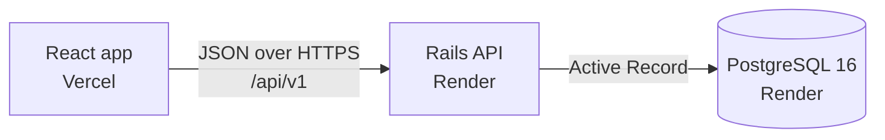

# Compliance Task Manager

A task manager for compliance teams at banks and credit unions, where every task belongs to a compliance module, has a priority and due date, and keeps an audit history.

- **App:** https://compliance-task-manager-seven.vercel.app
- **API:** https://compliance-task-manager-api.onrender.com/api/v1/tasks

> The backend runs on a free plan and sleeps when idle. The first request can take about a minute.

## Features

- Create, edit, complete, reopen and delete tasks.
- Filter by status (all, pending, completed), category (compliance module), priority and overdue, and search by title.
- Sort by newest, due date, priority or title.
- Pagination, with filters, sort order and page stored in the URL.
- Due date alerts: "Overdue by N days", "Due today", "Due tomorrow", "Due in N days".
- Audit history per task, showing what changed and when.

## Stack and architecture

| Layer | Technology |
| --- | --- |
| Frontend | React, TypeScript, Vite, native `fetch`, custom CSS |
| Backend | Rails 8.1 (API mode), Ruby 3.3.6 |
| Database | PostgreSQL 16 |
| Tests | Minitest, Vitest, Testing Library |
| Hosting | Vercel (frontend), Render (API and database) |



```text
.
├── .github/workflows/ci.yml     CI for both apps
├── render.yaml                  Render Blueprint (API and database)
├── backend/                     Rails API
│   ├── app/controllers/api/v1/  Tasks endpoints
│   ├── app/models/              Task and TaskEvent
│   ├── config/initializers/     Includes CORS
│   ├── db/                      Migrations, schema and seeds
│   └── test/                    Model and controller tests
└── frontend/                    React app
    ├── .env.example             Environment template
    └── src/
        ├── api/                 API client and URL configuration
        ├── components/          UI components
        ├── hooks/               Data fetching, URL state, search, toasts
        ├── types/               Types and display labels
        ├── utils/               Pure functions (dates, due status, query, events)
        └── test/                Test setup, fake API and factories
```

## Data model

**Task**

| Field | Type | Notes |
| --- | --- | --- |
| `title` | string | Required, 120 characters at most |
| `description` | text | Optional |
| `status` | string enum | `pending` (default), `completed` |
| `priority` | string enum | `low`, `medium` (default), `high` |
| `category` | string enum | `cra`, `hmda`, `fair_lending`, `section_1071`, `complaints`, `marketing_compliance`, `other` (default) |
| `due_date` | date | Optional |
| `overdue` | boolean | Computed, not stored: `pending` with a due date before today |

**TaskEvent** belongs to a task and is recorded automatically.

| Field | Type | Notes |
| --- | --- | --- |
| `event_type` | string | `created`, `updated`, `completed` |
| `metadata` | jsonb | Initial values for `created`. `{"field": [before, after]}` for the others |

Saving a task with no real change records no event. Reopening a task is recorded as `updated`.

## API reference

Base path: `/api/v1`.

| Method | Path | Description | Success |
| --- | --- | --- | --- |
| `GET` | `/tasks` | List tasks | 200 |
| `POST` | `/tasks` | Create a task | 201 |
| `GET` | `/tasks/:id` | Show a task | 200 |
| `PATCH` | `/tasks/:id` | Update a task, including its status | 200 |
| `DELETE` | `/tasks/:id` | Delete a task and its history | 204 |
| `GET` | `/tasks/:id/events` | List the task's history, newest first | 200 |

### Query parameters for `GET /tasks`

| Parameter | Values | Default |
| --- | --- | --- |
| `status` | `pending`, `completed` | all |
| `category` | any category above | all |
| `priority` | `low`, `medium`, `high` | all |
| `q` | Case-insensitive text matched against the title | none |
| `overdue` | `true` | all |
| `sort` | `created_at`, `due_date`, `priority`, `title` | `created_at` |
| `direction` | `asc`, `desc` | `desc` |
| `page` | Integer of 1 or more | `1` |
| `per_page` | Integer, limited to 1 through 100 | `20` |

Invalid filter or sort values are ignored. Tasks without a due date sort last in both directions, and ties are broken by `id`. A page past the end returns an empty `data` with status 200.

### Responses

List:

```json
{
  "data": [
    {
      "id": 1,
      "title": "Submit HMDA LAR to the CFPB",
      "description": "File the annual Loan/Application Register through the HMDA Platform.",
      "status": "pending",
      "priority": "high",
      "category": "hmda",
      "due_date": "2026-10-27",
      "created_at": "2026-11-08T14:41:31.368Z",
      "updated_at": "2026-11-08T14:41:31.368Z",
      "overdue": true
    }
  ],
  "meta": { "total": 1, "page": 1, "per_page": 20, "total_pages": 1 }
}
```

`meta.total` counts only the tasks that match the filters. With no results, `total_pages` is 0.

Validation error (422):

```json
{ "errors": { "due_date": ["is not a valid date"] } }
```

Not found (404):

```json
{ "error": "Not found" }
```

### Examples

These target a local server. See [Running locally](#running-locally).

```bash
API=http://localhost:3000/api/v1

curl "$API/tasks?status=pending&category=hmda&sort=due_date&direction=asc&page=1&per_page=5"

curl -X POST "$API/tasks" \
  -H "Content-Type: application/json" \
  -d '{"task":{"title":"File Q3 HMDA data","category":"hmda","priority":"high","due_date":"2026-12-01"}}'

curl -X PATCH "$API/tasks/1" \
  -H "Content-Type: application/json" \
  -d '{"task":{"status":"completed"}}'

curl "$API/tasks/1/events"

curl -X DELETE "$API/tasks/1"
```

## Running locally

Prerequisites:

- Ruby 3.3.6
- Node.js 24.15 or later (22.22.2 or later in the 22 line also works; the test tooling does not support Node 20)
- PostgreSQL 16, running locally and reachable by your system user (set `DATABASE_URL` to use another connection)

Backend, on http://localhost:3000:

```bash
cd backend
bundle install
bin/rails db:create db:migrate db:seed
bin/rails server
```

Frontend, in a second terminal, on http://localhost:5173:

```bash
cd frontend
npm install
cp .env.example .env
npm run dev
```

Keep the frontend on port 5173, since it is the only origin the API allows by default. To use another one, start the backend with `FRONTEND_URL` set to that origin.

## Testing

Backend:

```bash
cd backend
bin/rails test
```

Frontend:

```bash
cd frontend
npm test
TZ=America/Sao_Paulo npm test
TZ=Pacific/Honolulu npm test
npm run test:coverage
```

The time zone runs matter because date handling must not shift the day. Tests specific to one zone appear as skipped in the others.

Strategy:

- **Backend:** model tests cover validations, ordering and audit events. Controller tests cover filters, pagination and error formats against a real PostgreSQL database.
- **Frontend pure functions:** dates, due status, event descriptions and URL parsing have direct unit tests.
- **Frontend flows:** the app is rendered and driven through accessible roles and names. `fetch` is replaced by an in-memory fake API, so no test calls the real backend.

GitHub Actions runs the linters, the security scanners (Brakeman and bundler-audit), the frontend build and both test suites on pushes to `main` and on pull requests.

## Deployment

### Render (API and database)

`render.yaml` is a Blueprint that defines a Docker web service, built from `backend/`, with a health check on `/up`, and a PostgreSQL 16 database.

| Variable | Source |
| --- | --- |
| `DATABASE_URL` | Filled in from the Blueprint's database |
| `RAILS_MASTER_KEY` | Set in the Render dashboard. It must match the `backend/config/credentials.yml.enc` being deployed |
| `FRONTEND_URL` | Set in the Render dashboard. Comma-separated allowed origins, with no trailing slash |

Each start runs `db:prepare db:seed`, because Render's free plan has no shell for running seeds by hand. A real production app would not seed on start.

### Vercel (frontend)

| Setting | Value |
| --- | --- |
| Root Directory | `frontend` |
| Framework preset | Vite |
| `VITE_API_URL` | `https://compliance-task-manager-api.onrender.com/api/v1` |

`VITE_API_URL` is embedded at build time and is public, so changing it requires a new build and it must never hold a secret. Without it, the production build shows a configuration error. Vercel preview deployments use different origins, so they must be added to `FRONTEND_URL` to reach the API.

## Design decisions

- **String enums:** values stay readable in the database and in JSON, and do not depend on integer positions. `validate: true` turns an invalid value into a 422 instead of an exception.
- **Audit history through model callbacks:** any save through the `Task` model records an event, whichever code path triggered it, and controllers stay thin. Events are written in the same transaction as the change.
- **`due_date` validation on the raw value:** Rails casts an unreadable date to `nil`, which would silently erase it. The validator reads `due_date_before_type_cast`, so bad input gets a 422 while blank stays valid.
- **Explicit priority ordering:** priorities are strings, so alphabetical order would be wrong. `in_order_of` sorts them by rank.
- **Offset pagination:** it supports totals and jumping to a page, and is simple and sufficient at this scale. The `id` tiebreaker keeps rows from repeating or disappearing between pages. Keyset pagination would be the choice for very large tables.
- **Filters in the URL:** the query string is the single source of truth, so views can be shared and survive a reload, and the back button works.
- **Manual date parsing:** `new Date("2026-11-03")` is midnight UTC, which displays as the previous day west of UTC. Due dates are formatted as text and day differences are computed from parsed parts.
- **CORS through an environment variable:** `FRONTEND_URL` changes allowed origins per environment without a code change.
- **Custom CSS, no UI library:** the interface is small, so CSS variables cover the design tokens and dark mode without another dependency.

## Known limitations and future improvements

- **No authentication:** anyone with the link can read and change all tasks. Users and per-user audit attribution would come first.
- **Deleting a task deletes its history:** soft deletes or an immutable audit log would preserve it.
- **`overdue` is computed in UTC on the server:** due date badges use the browser's local day, so the two can disagree for a few hours around midnight. The overdue filter always follows the server.
- **Seeds only run on an empty table:** deleted or renamed sample tasks do not come back unless the table is completely empty.
- **Free hosting plan:** the server sleeps when idle and Render's free database has an expiration date.
- **Only two statuses:** an "In progress" status would be a natural addition.
- **Dependabot is intentionally not enabled:** Ruby dependencies are checked by bundler-audit in CI, but npm dependencies have no automated audit.
